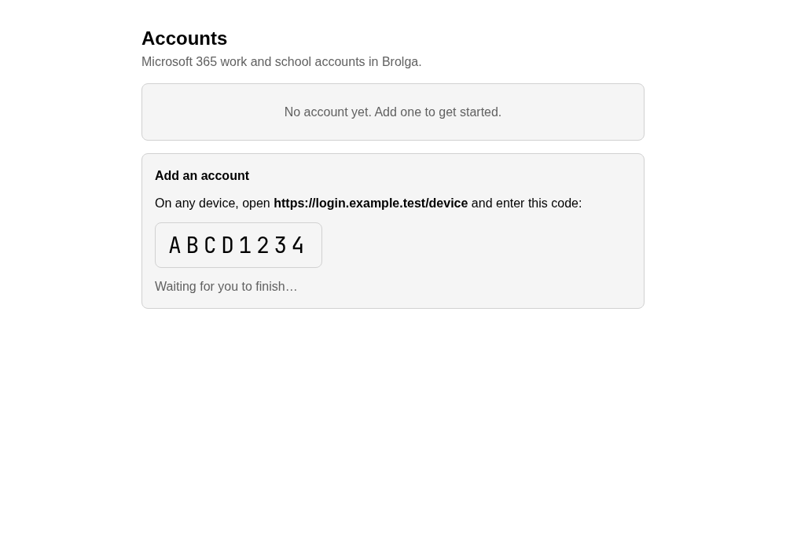

# Brolga

A native desktop client for Microsoft 365 mail, calendar and contacts, built
for Linux first, with Windows and macOS from the same code. It talks to
Microsoft Graph only, and everything it can do is also available to AI agents
through an MCP server, a command line and a local control channel.

**Status: milestone 1, sign-in and accounts.** You can sign in and stay
signed in. There is no mail or calendar yet.




The people and addresses in these pictures are made up. The pictures are taken
by the frontend's own tests (`SCREENSHOTS=1 bun run test` in `app/`), with a
stand-in for the core behind the window, so they show what the tests check.

- [The build spec](docs/build-spec.pdf)
- [Rules for contributors and agents](AGENTS.md)
- [Sources consulted](SOURCES.md)
- [brolga-cli](docs/cli.md), [MCP](docs/mcp.md), [the control channel](docs/control-protocol.md)

## Building

```sh
cd app && bun install && bun run build && cd ..   # the frontend, which the app crate embeds
cargo test --workspace
cargo run -p brolga-cli -- commands

cd app && bun run tauri dev                       # the window
cd app && bun run test                            # the window's own tests, in a headless browser
```

The window needs Tauri's system libraries; on Linux that is WebKitGTK 4.1.
To work on the core alone, name the crate: `cargo test -p brolga-commands`.

## Licence

[MIT](LICENSE).
