# Brolga

A native desktop client for Microsoft 365 mail, calendar and contacts, built
for Linux first, with Windows and macOS from the same code. It talks to
Microsoft Graph only, and everything it can do is also available to AI agents
through an MCP server, a command line and a local control channel.

**Status: milestone 5 under way.** Mail is built: sync, read, search, mark,
flag, categorise, move, archive and delete with undo, and write, reply,
forward and send with formatting, attachments and a signature. The calendar
can be read: day, work week, week, month and agenda, across your calendars,
with reminders. Invitations read as invitations and can be accepted,
tentatively accepted or declined, from the message or the calendar, and
events can be made, changed and deleted, repeating ones too: one occurrence,
that one and the rest, or the whole series. Meetings can be called, with
people invited and a Teams link, their answers seen, and cancelled with a
message. Mail has been run against a real Microsoft 365 mailbox; changing the
calendar has so far only been run against the stand-in server. When writing
a meeting, everyone's free and busy times can be seen and a time that suits
all taken. The room finder is not built yet.

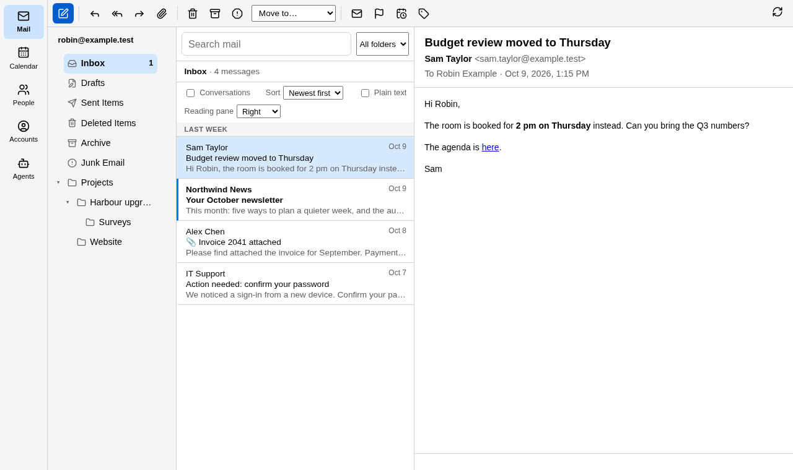

A message's remote pictures stay out until you ask for them, so a sender
cannot tell you opened it. A link that says one address and goes to another
is called out before you click it.

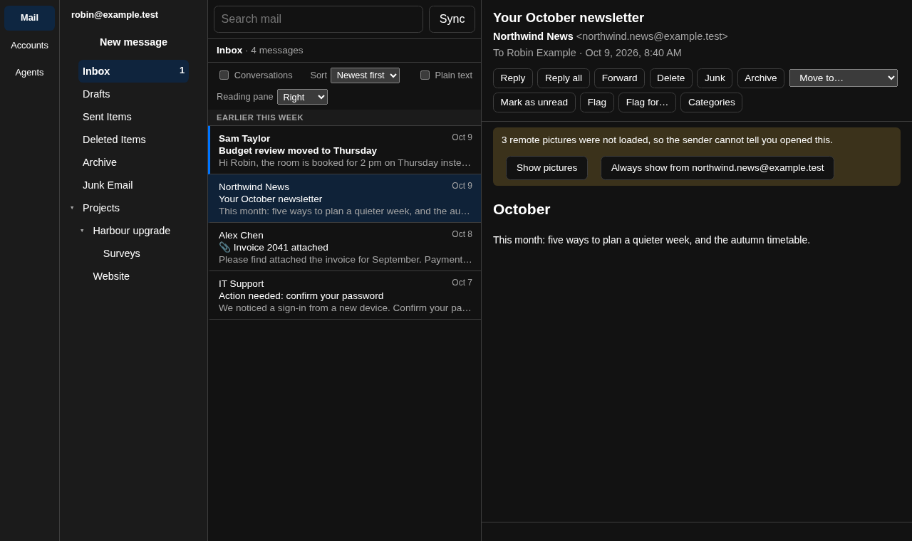

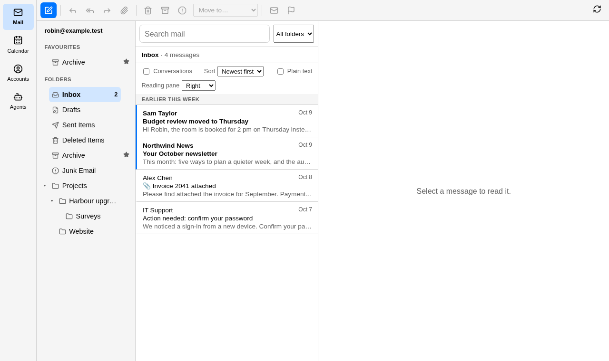

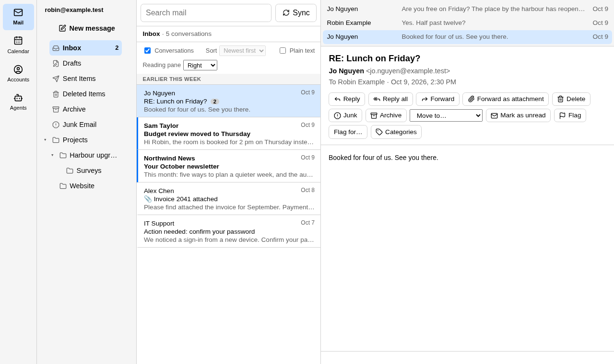

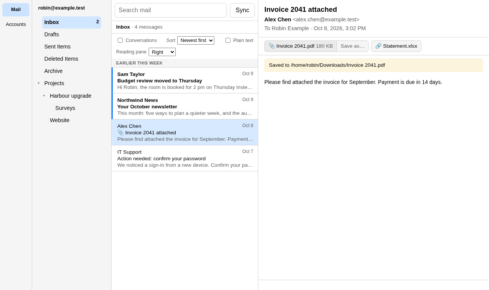

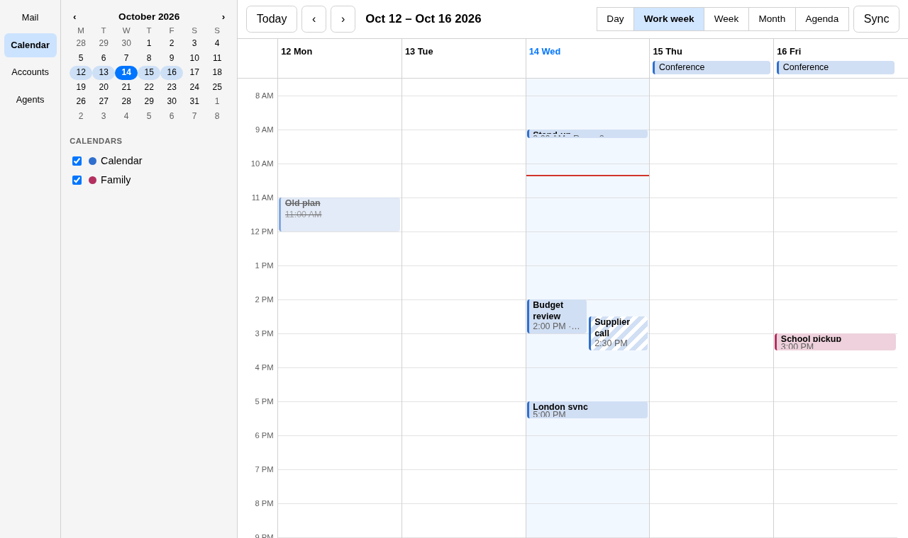

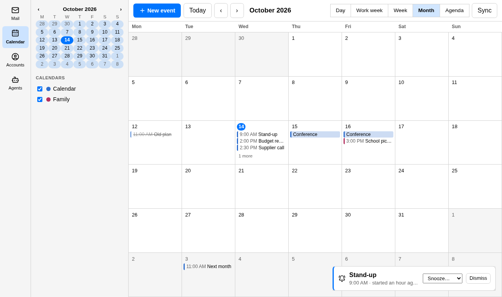

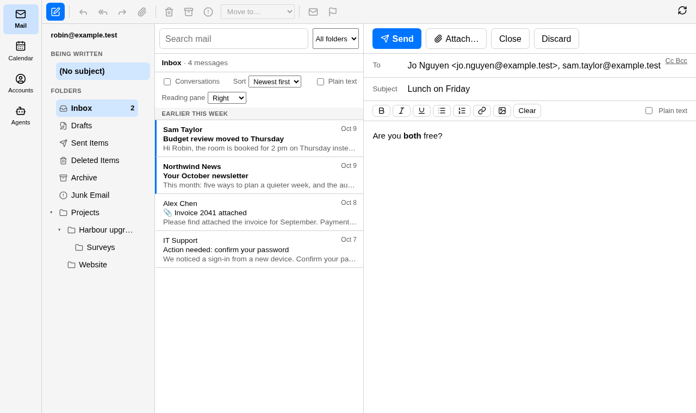

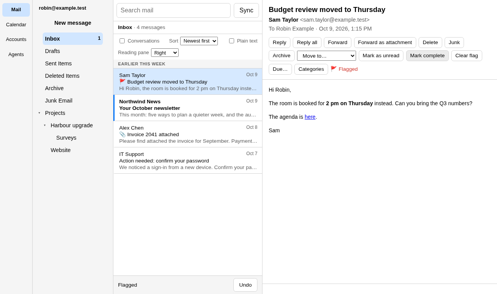

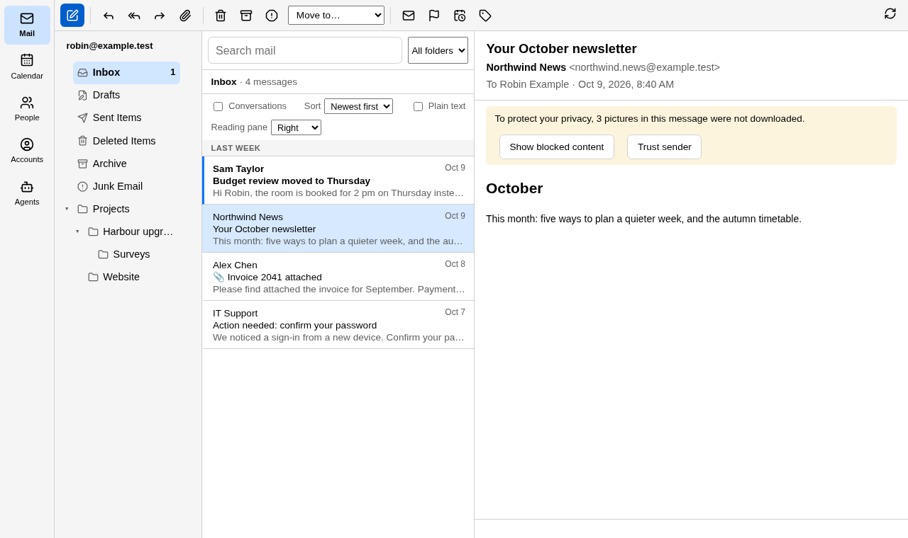

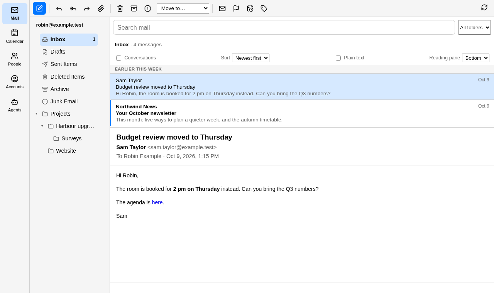

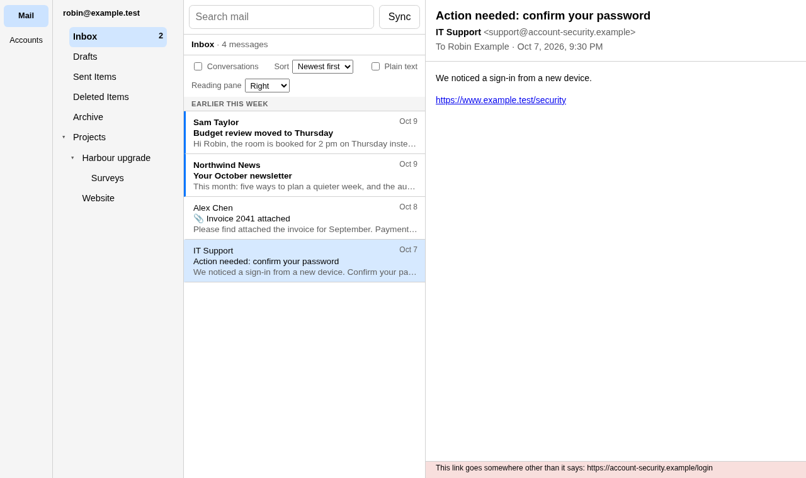

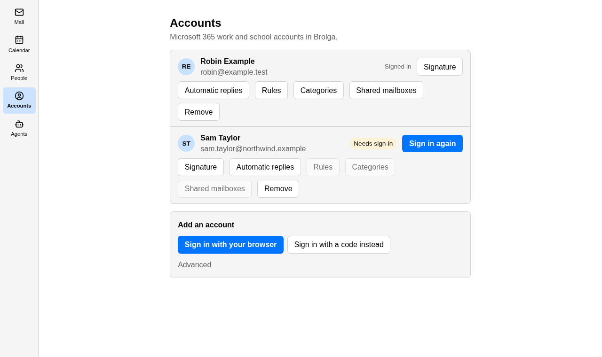

The people, addresses and messages in these pictures are made up. The pictures
are taken by the frontend's own tests (`SCREENSHOTS=1 bun run test` in `app/`),
with a stand-in for the core behind the window, so they show what the tests
check.

- [The build spec](docs/build-spec.pdf)
- [Rules for contributors and agents](AGENTS.md)
- [Sources consulted](SOURCES.md)
- [brolga-cli](docs/cli.md), [MCP](docs/mcp.md), [the control channel](docs/control-protocol.md)

## Building

```sh
cd app && bun install && bun run build && cd ..   # the frontend, which the app crate embeds
cargo test --workspace
cargo run -p brolga-cli -- commands

cd app && bun run tauri dev                       # the window
cd app && bun run test                            # the window's own tests, in a headless browser
```

The window needs Tauri's system libraries; on Linux that is WebKitGTK 4.1.
To work on the core alone, name the crate: `cargo test -p brolga-commands`.

## Licence

[MIT](LICENSE).
